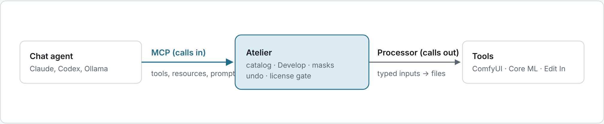

# MCP and Atelier Agent Actions

**Design proposal, November 11, 2026.** Not yet approved and not yet in the PRD. Backlog item: [AT-050](../BACKLOG.md#at-050--mcp-server-agent-actions-for-chat-clients). Published page with the same content: [Atelier Agent Actions](https://claude.ai/artifact/1zAwwGsuc14v3yZbxBfrB2) (private to Rosh).

This proposal lets Claude, Codex or a local Ollama model run Atelier's commands from a chat, through an MCP server that lives inside the app.

## Recommendation

Build it, but not as "every menu item becomes a tool." The PRD already plans an MCP server for agents (AI row, "Later"). It fits Atelier because the app is local, keyboard-driven and has clean commands. It's also the right way to give an agent control without anyone driving the screen.

Three choices make or break it:

- **One action registry.** Menus, keys, the right-click menu and MCP all read the same list of actions. Otherwise the agent ends up with its own copy of each command, which is the "same bug tool by tool" problem AGENTS.md warns about.
- **About 20 task-sized tools, not 150 menu clicks.** For example `set_metadata(photos, rating: 3)` instead of "press 3". Small local models choose well from a short list.
- **Atelier owns the safety.** Reads run freely and edits are undoable. Exports, AI jobs and Edit In ask in Atelier's own window. Deletes are never callable. This works the same whichever chat client or model is asking.

## How it fits together

The MCP server runs inside Atelier.app, because the app already holds the catalog, the selection, Develop state and undo. Local chat clients start a tiny helper, `atelier-mcp`, shipped inside the app bundle. The helper only passes messages to the running app over a private Unix socket. It never opens the catalog itself, so there's still exactly one writer.


*Solid lines ship first. Dashed amber parts (HTTP, other devices, Shortcuts) are optional later steps. The agent reaches the same handlers as a click, so undo, history and render coalescing work the same.*

### Why the app hosts the server, not a separate process

- **One writer.** A second process opening the catalog would race the app on GRDB writes and miss the app's undo stack and live Develop state.
- **Selection and "this photo".** Only the app knows what you're looking at. "Warm this one up a bit" needs that.
- **The helper keeps clients simple.** Claude Desktop, Claude Code, Codex and ollmcp all know how to launch a stdio server. The helper starts Atelier if it isn't running and waits for the catalog to open.

Config for any of them is one entry pointing at the helper. Settings would offer a Copy button for each client:

```json
{
  "mcpServers": {
    "atelier": {
      "command": "/Applications/Atelier.app/Contents/Helpers/atelier-mcp",
      "args": ["--profile", "edit"]
    }
  }
}
```

### Which clients can connect

- **Claude Desktop and Claude Code:** add Atelier as a local MCP server in their config.
- **Codex:** its config takes MCP servers too, both local and HTTP ones.
- **Ollama:** Ollama only runs the model, so a chat app in front of it has to speak MCP, such as `ollmcp` (mcp-client-for-ollama) in Terminal or Open WebUI. Gemma 4 and Qwen 3.6 can call tools but are less reliable than Claude at choosing among many, which is why the default tool lists are short and the risky steps are confirmed in Atelier.

## MCP points in, Processors point out

This does not add a second integration path. The Processor contract is how Atelier calls *out* to tools (ComfyUI, Core ML, Edit In apps, plugins). MCP is how an agent calls *in* to Atelier. When an agent runs an AI recipe, the tool calls the Processor host like the AI panel does, so provenance, licenses and the license gate stay the same.



## The action registry

Today commands live in three places. There are SwiftUI menus in `AtelierApp.swift`, 31 `KeyAction` cases in `KeyBindings.swift`, and the right-click menu in `PhotoMenu.swift`. Each calls `LibraryModel` on the current selection (for example `setRating` uses `pairTargetIDs`). The registry would make each action a value with:

- **id and title**, such as `library.setRating`, "Rate 3 stars". Menus and Settings > Keyboard show the title.
- **input schema**, the typed parameters (JSON Schema for MCP).
- **target**, which photos it applies to: `selection`, `current`, explicit ids, or a search. Handlers take resolved ids instead of reading the selection themselves. That is the main refactor.
- **risk tier** (below), which the guard reads.
- **handler**, the existing `LibraryModel` or `DevelopController` call.

`KeyBindings` stays as it is. A key is still bound to a command, and the command maps to a registry action. Some keys are view toggles (Show Before, Clipping, Mask Overlay). They become actions too, but they're left out of the default MCP profiles because an agent gains little by flipping them.

Apple was reported in 2025 to be testing MCP support through App Intents in macOS 26.1 betas. Built on a registry, Atelier could later publish the same actions as App Intents (Shortcuts, Spotlight) at little cost. Don't count on Apple's MCP bridge until it ships and is documented.

## Tool catalog

About 20 tools grouped by task. Each takes a `photos` target and returns what it changed. The client picks a profile, which decides how many tools the model sees:

- **Look:** read only.
- **Organize:** adds library and cull.
- **Edit:** adds Develop, presets, masks and Match Look.
- **Everything:** adds export, Edit In and AI.

For Gemma or Qwen, start with Organize or Edit.

| Area | Tool | What it does | Tier |
| --- | --- | --- | --- |
| Context | `get_context` | Mode, photo on screen, selection count, active filter, import or collection | Reads |
| | `search_photos` | Filter by rating, flag, label, keyword, date, camera, lens, import, collection, folder, edited or not | Reads |
| | `get_photo` | Metadata, shooting info, develop summary, stack and virtual copies (location left out unless allowed) | Reads |
| | `get_preview` | A rendered JPEG up to 1024 px, so a vision model can look at the photo (off by default) | Reads |
| | `list_items` | Imports, collections, presets, export presets, editors, AI recipes, built-in Match Look studies | Reads |
| Library | `show` | Select photos and switch to Grid, Loupe or Develop | Undoable |
| | `set_metadata` | Rating, flag, label, keywords, title, caption | Undoable |
| | `organize` | Add to a collection or new collection, stack, create a virtual copy | Undoable |
| Cull | `cull_groups` | Bursts and near-duplicates in an import, with Atelier's suggested keeper (sharpness, face quality) | Reads |
| Develop | `get_develop` | Current settings as named values (Exposure, Temp, Highlights…) | Reads |
| | `adjust` | Set or nudge named settings: `{"exposure": "+0.3", "temp": 5600}` | Undoable |
| | `auto` | Auto Tone or Auto White Balance | Undoable |
| | `apply_preset`, `sync`, `reset` | Apply a preset, copy settings from one photo to others (chosen groups), reset all or a group | Undoable |
| | `crop` | Aspect ratio, straighten angle, rotate | Undoable |
| Masks | `add_mask` | Select Subject, Sky, People (with parts), Linear or Radial, plus its adjustments. Brush stays manual. | Undoable |
| Match Look | `match_look` | Match to a catalog photo or built-in study, with Protect Skin Tones | Undoable |
| AI | `run_recipe` | Upscale or Replace Background as a background job with progress. Remove Object needs painting, so it opens the tool instead. | Asks first |
| Export | `export` | Export with a preset to a folder; license gate applies | Asks first |
| Edit In | `edit_in` | Open in an editor from Settings > Edit In | Asks first |
| Safety | `undo_change`, `job_status` | Undo one of the agent's own changes by id; check or cancel a running job | Undoable |
| Not exposed | — | Remove or delete photos, delete imports or collections, change Settings or keys. A request opens Atelier's own Remove sheet for Rosh to click. | Never |

### What a conversation looks like

> **Rosh:** In yesterday's Zf import, pick the best of each burst, give them 3 stars, then warm them a touch.

```text
search_photos({"import": "latest", "camera": "Nikon Z f"})
  → 212 photos in "Zf · Point Reyes"
cull_groups({"import": 41})
  → 37 groups, suggested keepers: [8812, 8820, …]
set_metadata({"photos": {"ids": [8812, 8820, …]}, "rating": 3, "flag": "pick"})
  → change c-17 · 37 photos · in Atelier: "Claude rated 37 photos ★★★ · Undo"
adjust({"photos": {"ids": [8812, …]}, "set": {"temp": "+300"}})
  → change c-18 · one history step per photo: "Temp +300 (Claude)"
```

## Safety: Atelier decides, not the chat client

Chat clients handle approval differently. Some ask before each tool call, and some let you approve everything at once. MCP has tool hints (`readOnlyHint`, `destructiveHint`) that Atelier sets, but clients only treat them as advice. The 2026-07-28 spec also changed how a server asks the user a question mid-call, and support for that varies between clients. So the guard inside Atelier enforces the rules, and confirmations appear in Atelier's own window.

| Tier | Behavior | Applies to |
| --- | --- | --- |
| **Reads** | Runs freely | Search, metadata, settings, cull groups. Previews only if turned on. |
| **Undoable** | Runs, then tells you | One undo step per call, named with the client: "Rate 3 stars (Claude)". A toast in the window offers Undo. More than 50 photos asks first (the number can be changed). |
| **Asks first** | Confirm in Atelier | Export, AI jobs, Edit In and XMP writes make files or launch apps. Atelier shows a sheet with what, how many and where, plus Allow and Cancel. |
| **Never** | Not a tool | Remove, Trash, delete import. If asked, Atelier opens its Remove sheet, and only Rosh's click deletes (with `DeleteFeedback`). |


*If Rosh clicks Cancel, or nobody answers within two minutes, the tool returns "declined by the user" and nothing is written. Long jobs report progress and can be cancelled, as in the AI panel.*

### Undo and history

- Each tool call is one undoable step, following the AGENTS.md rule that one edit is one history step. A call that rates 37 photos is one Undo, the same as a menu command on a selection.
- Develop history names carry the client: "Temp +300 (Claude)". The history panel shows the agent's changes alongside Rosh's own.
- Each result returns a `change` id. `undo_change` undoes only the agent's own changes, so the model can fix a mistake without undoing Rosh's.
- During a slider drag, an agent change to that photo waits until the drag ends, so it never fights the hand.

### Selection and targets

- Every write names its photos. `{"selection": true}` and `{"current": true}` are resolved when the call runs, and the result echoes the count and ids, so a selection changed mid-chat is never a silent surprise.
- Ids are catalog ids. Virtual copies have their own ids, and RAW+JPEG pairs follow the pair rule the menus already use.

## Privacy and reach

- **Local by default.** The stdio helper and Unix socket never touch the network. Atelier makes no outgoing calls for this.
- **The model decides where data goes.** With Ollama, nothing leaves the Mac. With Claude Desktop or Codex, whatever a tool returns goes to that provider as part of the chat, under Rosh's own subscription. That's not a paid API Atelier calls, but it does leave the Mac. So previews and GPS are off by default, and Settings shows which clients are connected.
- **From other devices (later, opt-in).** Atelier also serves Streamable HTTP. It listens on 127.0.0.1, or on the Tailscale address when remote access is turned on, and requires a token. The Mac must be awake with Atelier open.
- **claude.ai connectors** connect from Anthropic's servers, so they'd need a public HTTPS address with OAuth sign-in (for example Tailscale Funnel). Leave that out unless Rosh asks for it.

A new pane, Atelier > Settings… > Agents (under Editors & AI), would hold these switches and an activity log:


## Building it

Protocol: the official Swift SDK (`modelcontextprotocol/swift-sdk`) if it supports the 2026-07-28 spec by the time work starts. Otherwise a small JSON-RPC layer in AtelierCore, since a server with tools, a few resources and prompts doesn't need much. That spec drops the old initialize handshake and session ids, which helps for a stateless local server. The server code goes in Core with tests, and the app only adds the socket and the sheets.

| Phase | Scope |
| --- | --- |
| **A0. Action registry** | Move the menu, key and right-click commands onto one registry, with handlers that take resolved ids. No visible change. Tests in AtelierCoreTests. |
| **A1. Read-only MCP** | Helper, socket and the Look tools. Settings > Agents with on/off, Copy config and the activity log. Lets Rosh try Claude, Codex and Ollama safely. |
| **A2. Organize** | Ratings, flags, labels, keywords, collections, cull groups. Guard, toast and named undo steps. |
| **A3. Edit** | Develop adjust, auto, presets, sync, crop, masks, Match Look. Wait for an active drag. |
| **A4. Everything** | Export, Edit In and AI recipes with the confirmation sheet, background jobs, progress and Cancel. |
| **A5. Optional** | HTTP listener with Tailscale and a token, App Intents for Shortcuts, MCP prompts such as "Cull this import". |

Each phase is one PR, updating the PRD, Help (a new Agents page) and BACKLOG.md. A1 is the cheapest real test of whether this gets used day to day.

## PRD check

Nothing here contradicts the PRD, but these points need a PRD change once approved:

- **Scope and timing.** The PRD puts "MCP server for agents" under Later, with search, develop and recipe tools. This proposal brings it forward and widens it to library, cull, masks, Match Look, export and Edit In.
- **Privacy row.** "No network calls except NAS, user-configured backends and update checks." The stdio and socket path is fine. The optional HTTP listener and remote access would need a line added: off by default, loopback or tailnet only, token required.
- **Sandboxing row.** When the app is sandboxed, the helper and app share an App Group container for the socket. The HTTP listener needs the network-server entitlement.
- **One Processor contract.** Not affected, since MCP calls in and doesn't plug in tools. If Atelier ever *uses* MCP tools (for example a denoiser behind an MCP server), that goes through the Processor contract, not a new path.
- **UX principle 8, "every command is in a menu."** The registry makes this enforceable: a command without a menu entry would fail a test.

## Open decisions for Rosh

- Approve the direction, and whether A0 + A1 are the first bounded item.
- Remote access: leave it for later (recommended), or Tailscale in A1.
- Previews for cloud-hosted models (Claude, Codex): off by default with a switch (recommended), or never.

## Sources

**Primary**

- MCP specification, latest (2026-07-28): https://modelcontextprotocol.io/specification/latest
- MCP 2026-07-28 changelog: https://modelcontextprotocol.io/specification/2026-07-28/changelog
- MCP blog, 2026-07-28 release post: https://blog.modelcontextprotocol.io/posts/2026-07-28/
- MCP transports (draft): https://modelcontextprotocol.net/specification/draft/basic/transports
- Official Swift SDK: https://swiftpackageregistry.com/modelcontextprotocol/swift-sdk
- mcp-client-for-ollama (ollmcp): https://pypi.org/project/mcp-client-for-ollama/0.24.1/
- Atelier source at `8436d93`: `Requirements/Atelier-PRD.md`, `Sources/AtelierApp/KeyBindings.swift`, `AtelierApp.swift`, `PhotoMenu.swift`, `LibraryModel.swift`, `Sources/AtelierCore/Processors`

**Secondary**

- 9to5Mac, macOS Tahoe 26.1 beta and MCP in App Intents (Sept 2025): https://9to5mac.com/2025/09/22/macos-tahoe-26-1-beta-1-mcp-integration/
- Using MCP servers with Ollama and local LLMs: https://dev.to/hola_gus/how-to-use-mcp-servers-with-ollama-and-local-llms-f3
- Best local models for tool calling, 2026: https://www.promptquorum.com/power-local-llm/best-local-models-tool-calling-2026
