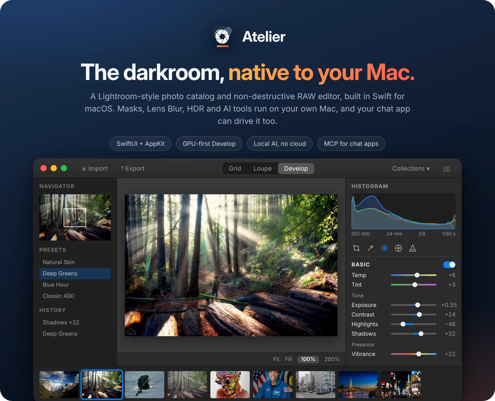
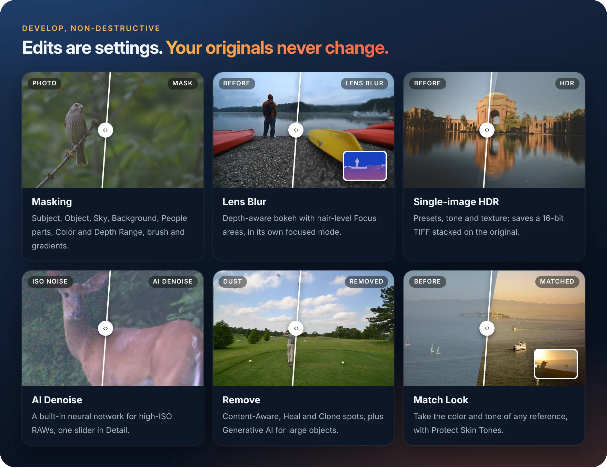
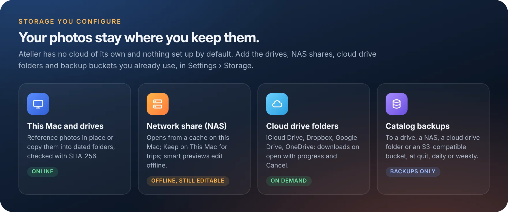
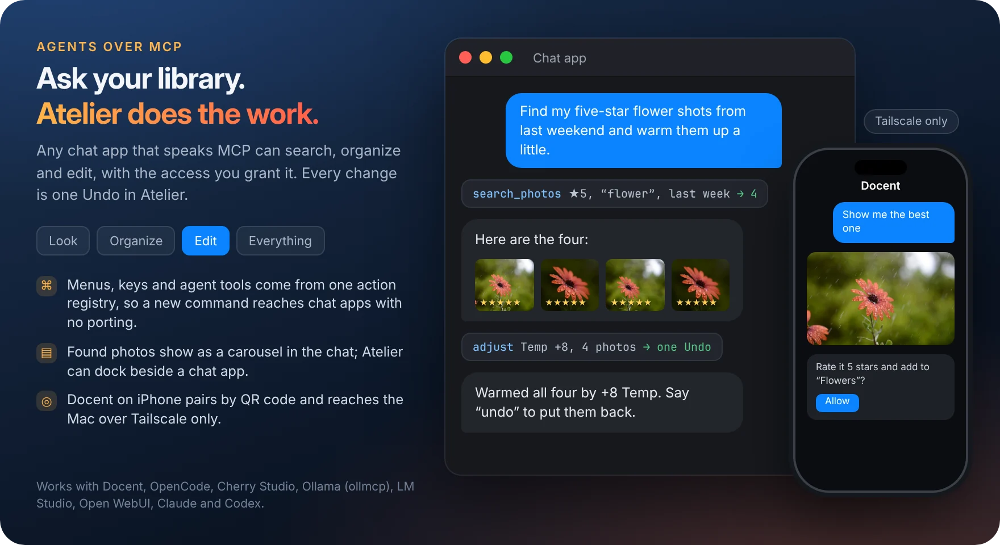

<p align="center">
  
</p>

<p align="center">
  <b>A personal Lightroom-style photo catalog and RAW editor for macOS.</b><br>
  Swift, SwiftUI + AppKit, macOS 15+. Apple Silicon first, Intel builds supported.
</p>

<p align="center">
  <a href="#features">Features</a> ·
  <a href="#storage-you-configure">Storage</a> ·
  <a href="#chat-apps-and-agents">Chat apps</a> ·
  <a href="#run-in-xcode">Run in Xcode</a> ·
  <a href="Sources/AtelierApp/Help/index.html">Help</a> ·
  <a href="Requirements/Atelier-PRD.md">PRD</a> ·
  <a href="BACKLOG.md">Backlog</a>
</p>

Scope and architecture follow [Requirements/Atelier-PRD.md](Requirements/Atelier-PRD.md), the source of truth; update it in the same PR as any change it covers.
Agents working in this repo follow [AGENTS.md](AGENTS.md).

> The pictures on this page are drawn from the app's Graphite theme, Help's before/after pictures and Rosh's own example photos (`Scripts/readme/make_readme_images.py`), not screenshots of a running build.

## Features

**Library**
- One catalog (SQLite through GRDB) in `~/Pictures/Atelier/Atelier Catalog.atelier`, snapshotted on quit (last 10 kept in `Backups/`), with optional backups to a drive, NAS, cloud drive folder or S3-compatible bucket (see [Storage you configure](#storage-you-configure)). If the catalog can't open, Atelier offers to try again instead of starting an empty library.
- Import dialog in steps (Choose Photos, optional Cull, Import): reference files in place or copy to `YYYY/YYYY-MM-DD Event/` with SHA-256 verification, from local drives, network shares and cloud drive folders you add, with a develop preset, Tone Curve and Color Grading presets and keywords applied on the way in. Volumes are matched by UUID, so remounted drives keep their links and show online or offline.
- Every import is a named entry in the sidebar: import more into it, rename it, remove photos, or delete it. Imports and collections can be marked private; their photos stay hidden until View > Show Private Photos… (Touch ID or your password).
- RAW+JPEG pairs shown as one photo, virtual copies, stacks for Edit In, AI, HDR and Lens Blur versions.
- Grid, Loupe and a full-width Filmstrip (F6) with its own source menu, filter and sort; folders, collections and a filter bar (rating, flag, label, text).
- Culling, before or after import: similar shots are grouped and the best is suggested by **Pick By** (Balanced, Sharpest Subject, Everyone's Eyes Open, Best Exposure, Classic), with Show Subject, Find Faces (Apple Vision, MediaPipe or both), blink and blurred-background-face checks, and reasons written to notes on dropped shots. Single keys keep or drop. Keys are rebindable in Settings > Keyboard; ⌘/ shows them all.
- Photo notes: a sticky note on any photo (lists, checkboxes, bold), shown over the photo in Library, Loupe, Develop and Cull, searchable, and written to XMP.
- EXIF, GPS and XMP read on import; XMP sidecars written on demand (Library > Write XMP for Selection, ⌘S, or automatically via Settings > Metadata), including current Develop settings, masks, retained history and snapshots, which are recovered when the photo is imported again. Virtual copies, stacks and provenance still require catalog backups.
- The last session (view, sidebar item, filter, photo, zoom and grid scroll) comes back on the next launch.

<p align="center">
  
</p>

**Develop** (non-destructive, GPU-first)
- RAW default look matched to the camera's embedded preview (Nikon Zf and Z6 tuned), plus a Profile menu.
- Basic, Tone Curve, HSL / Color and B&W, Color Grading, Detail, Lens Corrections, Transform (Upright and Guided), Effects (vignette, glow, grain) and Calibration panels, each with an on/off switch; Tone Curve and Color Grading have their own preset menus.
- **AI Denoise** in Detail: a neural network built into the app (PMRID) for high-ISO and underexposed RAWs, measured per photo.
- **Remove**: Content-Aware Remove, Heal and Clone spots stored as settings, plus Generative AI for people and large objects (through ComfyUI).
- **Masking**: brush, linear and radial gradients, Luminance, Color and Depth Range, Select Subject, Select Object, Select Sky, Select Background and Select People (face, body skin, lips, eyes, hair, clothes from a model built into the app), with Add, Subtract and Intersect, Grow, Refine Edge and optional Fine Edges (a BiRefNet download in Settings, Fast or Hair Detail). Masks have their own sliders, including Hue, Moiré, Defringe and Color Grading.
- **Lens Blur**: a depth-aware blur in its own focused mode, with Bokeh shapes, Focal Range, hair-level Focus and Blur areas, and Visualize Depth. Save makes a new photo stacked on the original.
- **Match Look**: match the color and tone of a reference picture, including Rosh's built-in studies, with Protect Skin Tones and Match Skin Tone.
- Crop and straighten, histogram with clipping, Before/After (side by side or slider), history and snapshots, presets with a built-in lookbook, zoom Fit, Fill, 100% and 200%.
- One slider everywhere: double-click the name to reset, click the value to type, ⌥-drag to see what it affects, arrow keys to nudge.
- Live slider frames go straight from the GPU to the photo view; Develop > Frame Diagnostics shows the frame times. Heavy AI models run in a helper process that quits when idle, so their memory goes back to macOS.

**Output and integrations**
- Export to JPEG, HEIC, TIFF or PNG with export presets (Website, Full-Size JPEG, Full-Size TIFF, plus your own) and a text or logo watermark.
- Edit In external apps through the Processor contract; edited files come back stacked with the original.
- Single-image HDR as a focused view of Atelier (Photo > HDR…, ⌃H), with presets; results are saved as 16-bit TIFFs stacked on the original (see [Single-image HDR](#single-image-hdr)).
- Experimental AI tools through a headless ComfyUI server (Remove Object, Replace Background, Upscale), set up in Settings > AI. Nothing generative is bundled.
- Chat apps over MCP: see [Chat apps and agents](#chat-apps-and-agents).
- Themes: System, Light, Dark, Graphite, Darkroom, Neutral Gray (Settings > Appearance). Settings has a sidebar of panes and a keyboard map.
- Atelier Help (Help > Atelier Help, ⌘?): every tool explained with drawn controls and interactive before/after pictures, in `Sources/AtelierApp/Help`. The pages also open in a browser.

## Storage you configure

<p align="center">
  
</p>

Atelier has no cloud of its own and sets nothing up by default. In **Settings > Storage** you add the places you already keep photos, and they show in the sidebar under **Locations** with Connect and Disconnect:

- **Drives and folders on this Mac.**
- **Network shares (NAS):** found with Bonjour or typed as `smb://…`, signed in with macOS's own sheet and Keychain. Photos open from a checked cache of originals on this Mac; **Keep on This Mac** and **Free Up Space** work on folders, imports and collections; Atelier asks when an original changed on the share since import.
- **Cloud drive folders:** iCloud Drive, Dropbox, Google Drive and OneDrive folders on this Mac; files not yet downloaded are badged and download on open with progress and Cancel.
- **Smart previews** let Develop edit a photo whose original is offline; the edits apply to the original when it is back.
- **Catalog backups** to any location or an S3-compatible bucket (Amazon S3, Backblaze B2, Cloudflare R2, Wasabi, MinIO), at quit, daily or weekly, or with File > Back Up Catalog.

## Chat apps and agents

<p align="center">
  
</p>

Chat apps reach Atelier over MCP (AT-050) through the `atelier-mcp` helper inside the app, with access granted per app in **Settings > Agents** (Look, Organize, Edit or Everything):

- **Look:** search the library, photo details, Develop settings, cull groups and menu commands. "Show me this photo" shows it in the chat, and chat apps see previews switch live.
- **Organize:** select, rate, flag, label, keyword and collect photos, with Undo.
- **Edit:** adjust Develop sliders, run Auto, apply presets, sync and reset settings, crop and straighten, add masks and match a look. Several changes can go in one batch, all or nothing with one Undo.
- A chat app such as Docent can dock Atelier's window beside it and show found photos as a carousel (an MCP Apps view).
- **From an iPhone:** Docent on iPhone pairs by QR code (Settings > Agents > Phone, off by default) and reaches Atelier over Tailscale only, with the same tools and its own Allow.
- Menus, keys and the photo menu are built from one action registry, so every command reaches chat apps with no extra porting. Export, Edit In and AI recipes for agents follow in AT-050e.

[Connect a chat app](Sources/AtelierApp/Help/chat-apps.html) shows setup for OpenCode, Cherry Studio, Ollama (ollmcp), LM Studio, Open WebUI, Claude and Codex. The design is in [Docs/Atelier-Agent-Actions.md](Docs/Atelier-Agent-Actions.md).

## Documentation

| Where | What it covers |
| --- | --- |
| [Requirements/Atelier-PRD.md](Requirements/Atelier-PRD.md) | The product spec, the single source of truth |
| [BACKLOG.md](BACKLOG.md) | Every action item and its status |
| [AGENTS.md](AGENTS.md) | Rules for coding agents: design principles, git, PRs, checks |
| Atelier Help, [`Sources/AtelierApp/Help`](Sources/AtelierApp/Help) | The user guide, shown in the app (⌘?) |
| [Docs/Atelier-Architecture.html](Docs/Atelier-Architecture.html) | How the app is built: targets, catalog, render pipeline and threads, models, agents, and where code and PRD differ (as of c146785) |
| [Docs/Automated-Testing.md](Docs/Automated-Testing.md) | Running the local checks and reading their reports |
| [Docs/Atelier-Agent-Actions.md](Docs/Atelier-Agent-Actions.md) | Design of the MCP server, action registry and agent access (AT-050) |
| [Docs/agent-actions-catalog.json](Docs/agent-actions-catalog.json) | Every command agents can reach, generated by `Scripts/agent_catalog.py` |
| [Scripts/readme](Scripts/readme) | The pages behind this README's pictures; `python3 Scripts/readme/make_readme_images.py` redraws them into `Docs/readme/` |

## Run in Xcode

1. Xcode > File > Open…, pick `Package.swift` in the project folder.
2. Choose the **AtelierApp** scheme and **My Mac** as the destination in the toolbar.
3. Product > Run (⌘R).

From a terminal: `swift build`, `swift test`, `swift run AtelierApp`.

## Release builds for Apple Silicon and Intel

`Scripts/build_macos_app.py` builds a movable, ad-hoc-signed `Atelier.app` (HDR is part of
it) in the Release configuration. `--arch` picks the processor:

```sh
python3 Scripts/build_macos_app.py --arch all        # arm64, x86_64 and universal, side by side
python3 Scripts/build_macos_app.py --arch universal  # one app that runs natively on both
python3 Scripts/build_macos_app.py --arch arm64      # Apple Silicon only
python3 Scripts/build_macos_app.py --arch x86_64     # Intel only
python3 Scripts/build_macos_app.py                   # this Mac's processor (as before)
```

Apps land in `.build/Applications/<arch>/Atelier.app` (`.build/Applications/Atelier.app` for
the default). Each arch is built with `swift build -c release --triple <arch>-apple-macosx15.0`;
universal joins the two executables with `lipo`. Release builds keep their symbols in `Atelier.app.dSYM` next to the app and strip them from the app itself (about 29 MB smaller); keep the dSYM with the app so crash logs show function names. Check a result with
`lipo -archs .build/Applications/universal/Atelier.app/Contents/MacOS/AtelierApp`. An Intel build
runs on an Apple Silicon Mac under Rosetta (`softwareupdate --install-rosetta` once). These are
local builds, not notarized: another Mac needs right-click > Open the first time.

In Xcode (`Package.swift` open, scheme **AtelierApp**):

- Release instead of Debug: Product > Scheme > Edit Scheme… (⌘<), select **Run** on the left,
  **Info** tab, set **Build Configuration** to **Release**, Close. Set it back to Debug for everyday work.
- Universal: Product > Destination > **Any Mac (Apple Silicon, Intel)**, then Product > Build (⌘B).
  Any Mac builds but does not run.
- Run the Intel build on an Apple Silicon Mac: Product > Destination > Destination Architectures >
  **Show Rosetta Destinations**, then pick **My Mac (Rosetta)** and Product > Run (⌘R).

What differs on Intel: develop rendering, Vision masks and culling all work, but slower
(no Neural Engine, weaker GPUs). The ComfyUI AI tools need an Apple Silicon Mac in practice,
since current PyTorch no longer ships Intel Mac builds. MLX, when added, is Apple Silicon only
and must be hidden on Intel. See the PRD's Non-functional requirements > Compatibility.

## Sharing Atelier and updates

Atelier is shared as a file from the public [atelier-releases](https://github.com/roshan-davis/atelier-releases/releases)
repository (no source in it): a `.dmg` to install and a `.zip` that installed copies update from.
Atelier checks for new versions (Sparkle 2, that repository's `appcast.xml`), installs them when you quit, shows What's New once
after each update, and backs up the catalog before any upgrade. Make a release with
`python3 Scripts/release/make_release.py`; [Docs/Releasing.md](Docs/Releasing.md) has the steps,
signing choices (ad hoc, self-signed or Developer ID) and how to test an update. Builds run from
Xcode never check for updates.

## CI

[.github/workflows/build.yml](.github/workflows/build.yml) is configured for main pushes and PRs: macOS build, tests and layout snapshots. Check the actual run status; configuration alone does not prove Actions is available or passing. The local command below works without GitHub setup. RAW sample tests can skip when fixtures are unavailable.

## Not built yet

Smart collections, perceptual-hash duplicates, watch folders, App Sandbox, model registry and license gate for AI outputs, PSD round-trip, Core ML and MLX backends for generative AI (generative tools run through ComfyUI; the built-in mask, denoise and depth models run on the Mac), bracketed HDR and panorama merge, Adaptive presets, and chat agents that export, open Edit In or run AI recipes (AT-050e; reading, organizing and Develop edits work today). See the PRD for the phase plan and [BACKLOG.md](BACKLOG.md) for status.

## Local pre-PR checks (Mac agents)

Run from your task branch before opening or updating a PR:

```sh
git fetch origin main
python3 Scripts/check_pr.py
# Optional existing RAW fixtures (no automatic downloads):
python3 Scripts/check_pr.py --samples /absolute/path/to/sample-raws
```

Requires full Xcode and Python 3; the first Swift build may resolve dependencies over the network.
The script checks committed and working-tree whitespace against the merge base with `origin/main`
(and untracked files, accepting Git’s silent new-file difference status while retaining whitespace and command failures), runs its regression tests, validates Help and its generated index without rewriting it,
builds the app, and runs the tests. It exits nonzero if any check fails and retains individual
logs plus `summary.txt` in `.build/local-checks/<run>/`, including the tested commit and working changes.
It honors `DEVELOPER_DIR`, otherwise uses selected Xcode or `/Applications/Xcode.app` when only
Command Line Tools are selected. It never changes the global Xcode selection.

Report failures and skipped RAW tests in the PR; a successful run does not certify real-RAW
coverage or visual layout. Use the UI checks in the [Automated testing guide](Docs/Automated-Testing.md) for app interactions and screenshots.
This local check requires no GitHub configuration and leaves the existing Actions workflow intact.
Use `--base <ref>` to check against a different fetched PR base. Agent workspace and environment
rules are in [AGENTS.md](AGENTS.md#where-you-work). Cloud Claude cannot execute this Mac-only
command; its PR must disclose that and receive a Mac check before validation is complete.


## Automated testing

See the [Automated testing guide](Docs/Automated-Testing.md) for the full suite, repeatable
group selectors, suggested checks by change type, and how to read the reports.

## Single-image HDR

HDR is a view of Atelier, next to Grid, Loupe and Develop (there is no separate HDR app
any more). Select one photo and choose **Photo > HDR… (⌃H)**, or right-click > **Edit in HDR**.
HDR reads the original's pixels rather than baking Atelier Develop adjustments, and has its
own presets with thumbnails. **Save HDR** (⌘S in HDR) writes a full-resolution profiled
16-bit sRGB TIFF stacked with the original and creates an HDR project (`.atelierhdr`)
beside it on first Save. Leaving without saving asks first; nothing is written before a Save,
and saves keep only the current and previous generations. **Photo > HDR…** on the HDR TIFF
reopens its project; **File > Save HDR As New… (⇧⌘S)** forks a new project and result.
Help > Atelier Help > Single-image HDR explains every control.

Bracket processing and batch are not built yet. Back up the project package and TIFF as
well as the catalog. HDR engine tests run without opening the app:

~~~sh
swift test --filter AtelierHDRCoreTests
~~~
