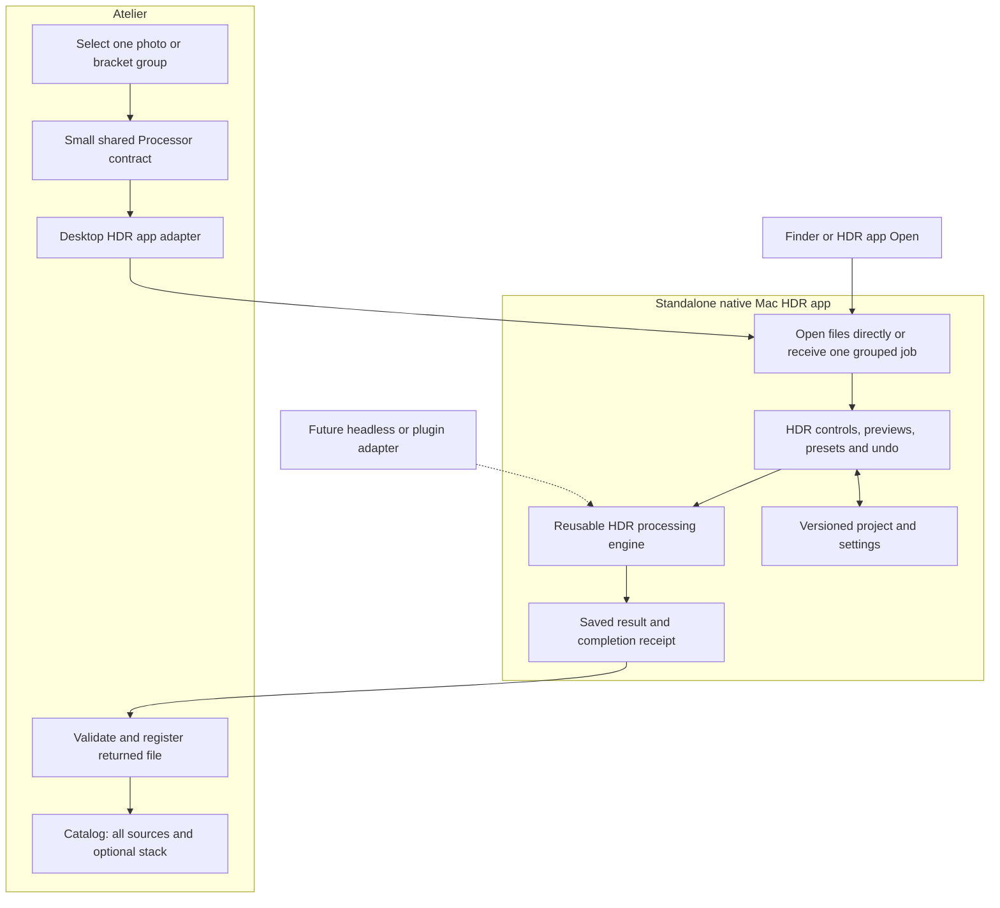

# AT-021: standalone HDR app and a focused Atelier round trip

> **Superseded for delivery (Rosh, Nov 12, 2026, AT-052):** HDR is now a view inside Atelier, not a standalone app; there is no job document, receipt or second process for single-image HDR. This record stays for the engine, project and bracket design. See the PRD section "HDR view and grouped Edit In".

**Agreed direction and phased design record, October 30, 2026.** Rosh requested this pivot after discussing Machinery HDR. Source baseline: `8700f853bb9d5d06c906e9d8800b5137b5581a33`. The PRD HDR editor section is authoritative; this record explains the agreed direction and remaining feasibility questions. Algorithms, dependencies and detailed implementation still require bounded scope. No runtime, rendering or catalog schema changes are made here. The existing filename is retained so PR links continue to work.

## The pivot

Prioritize a standalone native Mac HDR editor inspired by Machinery HDR, with a reusable image-processing engine. Atelier sends a single photo or a group of bracketed photos to that app and registers the returned result. Defer the general third-party plugin platform: discovery, installable manifests, arbitrary CLI/HTTP tools, generated forms and plugin-contributed menus are not prerequisites for this HDR app.

Keep a small shared **Processor contract** for the Atelier connection, consistent with the existing one-contract product rule. Extend the current Edit In pattern to grouped inputs and many-source results through this contract; do not create a special HDR-only catalog/import path. There is no prerequisite to migrate or rewrite ComfyUI before HDR development. Existing Edit In and AI workflows remain supported; AI order stays ComfyUI → Core ML → MLX, nothing bundled.

This supersedes the previous “full plugin architecture first, HDR as its first plugin” delivery plan. HDR is now a separate interactive app connected as a desktop Processor. A headless HDR adapter or broader plugin system can be considered later using the same engine and contract.

## What the HDR product means

Machinery's manual describes both bracket fusion/alignment/deghosting and single-image creative processing, including microcontrast, detail enhancement, smoothing, dynamic contrast and presets [8]. The desired product therefore goes beyond a Lightroom-style merge dialog. It is an independently useful HDR editor, not merely a launcher around a merge executable. Inspiration means comparable workflows and visual goals, not copying proprietary algorithms, assets or UI.

- **One image:** interactive tone/local-contrast/detail work and presets. It cannot recover scene information absent from the input; synthetic exposures do not add captured dynamic range.
- **Multiple bracketed images:** alignment, merging, deghosting, then interactive tone/detail work.
- **Native editing:** responsive previews, before/after, undo, cancellable background work, saved versioned settings/projects and full-resolution output. Exact controls and first-release scope need design agreement.
- **Independent use:** open photos without Atelier. The app owns HDR-specific editing UI and projects; Atelier owns its catalog, input selection, source relationships and returned-photo organization.

A rendered return TIFF is a derivative; it does not make all HDR adjustments reversible in Atelier Develop. Preserve the HDR project's settings and input identities separately so reopening in the HDR app can restore editing. The agreed first return is tone-mapped 16-bit TIFF with a project beside it: re-edit opens the project, Save refreshes the same result, and Save As New returns a new version. Durable source ownership and transport details are feasibility questions.

## Responsibilities and one execution path

These diagrams describe the revised proposal, not shipped capabilities.

### Architecture: separate app, reusable engine, one Atelier connection



The HDR engine contains decoding/preparation, alignment, merge/deghost and tone/detail processing without catalog or UI dependencies. The HDR app owns its native interaction and project persistence. Atelier's adapter owns job preparation, launch/reconnect and result validation/publication through shared Core services. Keep a reusable HDR engine and second app product in this repository, extracting shared UI pieces only as needed. App name and distribution are still open. No HDR math belongs in AtelierApp controllers.

### Round trip: one selection becomes one HDR session

```mermaid
sequenceDiagram
    actor User
    participant Atelier
    participant HDR as HDR app
    participant Engine
    User->>Atelier: Select one image or several brackets
    User->>Atelier: Edit In > HDR app (proposed)
    Atelier->>Atelier: Snapshot inputs and prepare grouped request
    Atelier->>HDR: Open job with staged inputs and return contract
    HDR->>Engine: Merge if bracketed; preview tone/detail settings
    Engine-->>HDR: Updated preview
    User->>HDR: Save result / return to Atelier
    HDR->>HDR: Save project, output and completion receipt
    HDR-->>Atelier: Result ready for this job
    Atelier->>Atelier: Validate, publish and record every source
    Atelier-->>User: New catalog photo; stack according to agreed policy
```

This is different from today's Edit In, which prepares and opens each selected photo individually. The new operation explicitly groups the selected inputs into one session; it does not change ordinary multi-photo Edit In semantics. Saving a standalone HDR project need not automatically import every intermediate preview or export into Atelier. The exact Save/Return commands require UX agreement.

### Delivery order: HDR-focused work, broader plugins later


The first editor slice includes the Atelier round trip; the small contract is designed alongside the HDR app; the diagram orders acceptance gates, not a requirement to defer all integration design until the app is finished. General plugin discovery/security, generated forms and a ComfyUI migration do not block this path.

## Minimum Atelier Processor contract

Use a fixed desktop-app adapter initially, not a public extensibility framework. Core owns types, preparation, output validation and registration. AppKit launch/activation stays in Atelier's app layer. Current export/stack helpers supply existing behavior but need bounded extensions for one grouped job and multiple sources.

| Record | Minimum meaning |
| --- | --- |
| Request | Version, UUID job ID, operation, ordered input IDs, reference input, immutable settings snapshot and requested input/output representation |
| Input | Staged file identity/hash, role, dimensions/orientation, original versus rendered representation, sample precision, color profile/transfer function and exposure metadata with explicit unknowns |
| Handoff | Job-local request location, app identity and agreed return location/receipt; transport mechanism chosen in a small spike, not assumed from an ordinary Open Files event |
| Result | Job ID, stable output identity/path/hash, all source mappings, reference frame, actual output format/color/precision, project reference if agreed and engine/settings version |
| Status | Preparing, handed off, result ready, validating, registered, cancelled or failed; reason/recovery action and optional progress where actually available |

No silent conversion of RAW brackets to developed 16-bit TIFF. Single-image “edit as developed” and bracket “use originals” are distinct input policies requiring clear labels. Use staged copies, never hard links or writable originals. Grant no catalog access to the HDR app. A desktop app is its own trust boundary; this connection does not claim that a child process or path convention provides an OS sandbox.

A registered job-document type opened with NSWorkspace, followed by an atomically written result receipt in the job directory, is the candidate transport to prove; launching, completion signaling, saved projects and relaunch must be proven on Mac before freezing it. Do not depend on desktop automation, arbitrary scripts, or filenames alone to correlate results. Reopening a project cannot depend solely on temporary staging files: the project must retain durable copies or explicitly resolvable references, with ownership/cleanup and missing-source behavior agreed before implementation.

## Publication, cancel and recovery

Atelier validates regular output files, expected representation, profile/precision, size and decode success before import. Restrict return paths, reject traversal/symlinks and never overwrite originals. Use unique destination names and retain existing source-folder/managed-Edits behavior unless a different destination is agreed. Treat import/relationship updates and filesystem publication as a recoverable operation with a receipt: today's `addStacked` imports and stacks separately.

Record **all** bracket sources regardless of whether the user creates a visual stack. Reference-frame metadata inheritance and stack placement must be explicit; copying a single frame's exposure onto the merged file would be misleading. Coordinate relationships/provenance with AT-005b/c and AT-007, without implementing a new license policy in this work.

Cancellation before handoff stops preparation. After handoff, Atelier can abandon its pending import or request cancellation through an agreed app protocol; it must not kill the user's HDR app or discard a saved project. Cancelling a merge inside the HDR app stops that computation while preserving the session. Closing without returning produces no new catalog photo. Late results for abandoned jobs require an explicit recovery action, not automatic import.

After a crash/relaunch, correlate receipts by job ID, reconcile already registered outputs and avoid duplicates. Do not automatically rerun an expensive merge. Retain recoverable results with a visible location/action. Re-edit opens the associated project; Save updates the same TIFF, and Save As New returns a new result. Reuse EditWatcher for image refresh, but it does not already implement receipt discovery, project association or many-source recovery.

## HDR engine and format feasibility

Qualify decoder and input representation first. Scene-linear demosaiced RGB is not untouched sensor mosaic RAW. Today's neutral `Exporter` TIFF is not a validated RAW-merge input. Compare a qualified RAW-capable merger with a linear-RGB approach using Nikon Zf/Z6 brackets. Record dependency versions/licenses; no algorithm or dependency is adopted by this design.

The first editor should distinguish a high-dynamic-range master/project from the tone-mapped output used for ordinary viewing. Preserve reversible processing settings in the HDR project. Do not promise Lightroom-equivalent deghosting, ±10 EV Develop support or true HDR display/export simply because a float file can be written.

| Candidate | Verified research | Still to prove |
| --- | --- | --- |
| Machinery-style workflow | Manual documents single-image effects, bracket fusion, alignment/deghost, presets, project saving and Lightroom round trip [8] | Desired visual style, controls and algorithm quality on Rosh's images; source does not expose proprietary math |
| OpenCV | Tutorial separates float HDR merging from low-dynamic-range exposure fusion [2]; AlignMTB exposes shift alignment [3] | RAW preparation, handheld rotation/parallax and suitable deghost; not a complete Machinery substitute |
| Float TIFF | Apple exposes TIFF writing with a pixel-format argument [4] | Numeric round trip above 1/below 0, tags/profile/metadata, actual precision, Atelier decode/Develop/export |
| DNG | Adobe supplies specification and SDK resources [5] | Exact SDK terms/dependencies, float linear-DNG writing and independent reader tests |
| OpenEXR | Format supports float channels/color metadata [6] | Encoder/dependency, metadata carriage and Atelier import/preview/Develop support |

Benchmark responsive preview updates and full-resolution render time/peak memory before optimization. Coalesce preview work and discard stale settings revisions. Test single-image natural/detail-heavy looks and bracket sets with moving subjects, tripod/handheld shifts, clipped highlights, mismatched dimensions/orientation, missing exposure metadata, mixed RAW/JPEG, offline originals and read-only folders. No synthetic bracket can restore uncaptured information.

## Bounded delivery plan and acceptance

Each implementation slice gets its own scope/approval and PR/chat. This PR revises the design only.

| Phase | Scope | Gate |
| --- | --- | --- |
| 0 — this design | Agreed standalone direction, first TIFF return and project re-edit; defer full plugins | Design completion only; no HDR runtime or visual acceptance |
| 1 — prove image path | Disposable single-image/bracket fixtures, decode/alignment/basic merge, 16-bit TIFF profile/highlight tests, project sources and job-document/receipt feasibility | Record method, license/dependency and time/memory evidence; settle initial controls and bounded implementation scope |
| 2 — small end-to-end slice | Second Mac app in this repo, reusable engine/shared controls, one window, one-image/bracket inputs, approximately four–six agreed tone/detail controls, undo, project/TIFF save/reopen and grouped Atelier return | Original preservation, all-source registration, valid profile/precision, basic cancel/close/crash/relaunch/duplicate safeguards and Rosh's image/UI acceptance |
| 3 — re-edit/recovery completion | Project re-edit, same-result Save versus Save As New, relink and complete interruption/restart matrix | No silent source loss, duplicate imports or abandoned-job auto-return; basics already covered in phase 2 |
| 4 — expand after acceptance | Presets, richer single-image effects and deghost quality/controls; bracket detection and batch later | Image fixtures and measured preview/full-size performance; each feature separately scoped |
| Deferred — plugin platform and float return | General manifests/discovery/forms/CLI/HTTP, AI migration; float HDR master and extended Develop range | Separate proposals; not prerequisites for this editor |

Dependencies: AT-008 supplies the one-contract boundary without a prerequisite broad migration; AT-005b/c cover portable source/project relationships and provenance recovery; AT-007 governs identity/license policy; AT-009 covers durable/offline queues later. Existing model restrictions and backend order remain unchanged. Do not silently implement those proposals as part of HDR work.

Decisions still open: app/package name; exact first controls and merge/deghost method; original/rendered input labels; dependency selection; durable source ownership; receipt signaling and stack placement. Agreed: same repository, second app, TIFF first, project-based HDR re-edit, one small end-to-end slice. The PRD retains the deferred Lightroom-style shortcuts, float/±10 EV, deghost controls/overlay, headless and batch requirements.

Future Atelier testing covers main and context Edit In menus in grid/Loupe/Develop/Filmstrip, grouped RAW+JPEG handling, selection, return registration and existing external-save/AI flows. HDR app tests cover preview interactions, before/after, zoom/pan, sliders, undo, presets and project reopen. PRD/Help/snapshots accompany actual UI work. Desktop/UI testing always requires fresh explicit permission from Rosh; none was performed here.

## What exists, and what must remain

Paths below are relative to the repository at the baseline revision.

| Concern | Verified source behavior | Design consequence |
| --- | --- | --- |
| Edit In | `Sources/AtelierApp/EditIn.swift`, `LibraryModel.editIn`: detached sequential preparation, `Exporter.export`, `Importer.addStacked`, then `NSWorkspace.open`; per-photo problems; existing external edits reopen directly | Preserve TIFF/JPEG, per-app color/develop options, selection and partial success; opening an editor is a handoff, not a completed pixel computation |
| Live edits | Same file, `EditWatcher`: watches directories, debounces saves, checks modification time; `editedFileChanged` refreshes catalog and previews | A registered editable artifact has an ongoing observation lifecycle after the preparation job ends; cancel must not close another app or delete a registered edit |
| Output | `Sources/AtelierCore/Catalog/Catalog+Stacks.swift`, `addStacked`: imports then separately stacks; `Catalog.stack` copies catalog metadata/collections/import entries; `DerivedFiles.folder` chooses source folder or managed Edits | Reuse these semantics, but publication needs idempotency/reconciliation because import + stack + filesystem writes are not one atomic transaction |
| Relationships | `PhotoVersion` records one parent and optional provenance JSON | Many HDR sources and optional visual stack membership cannot be represented merely by repeating today's single-parent call; coordinate AT-005b/c and AT-007 before migrations |
| Precision | `Exporter.swift` renders TIFF as `.RGBA16`, other formats `.RGBA8`; `AIRunner.write` can widen generated samples to 16 bits | Neither path proves scene-linear float retention or creates lost precision; precision metadata must distinguish container from effective source precision |
| Develop | `DevelopRenderer.swift`: extended-linear Rec.2020 working space, half-float context, display conversions to 8-bit, RAW/non-RAW branches; non-RAW positive exposure uses `ExposureRolloff`; `DevelopSettings.Parameter.range` gives Exposure −5…5 | A float encoder alone does not establish an HDR editing path; test decode, pipeline clamps/rolloff, previews and export before offering extended exposure |

Later plugin/AI work: there is no concrete shared Processor protocol/host in the inspected baseline; ComfyUI migration and generic menu contribution work are deferred. README's contract wording describes the intended architecture, not completed orchestration. No durable common job queue was found in these flows.

## Primary research (accessed October 30, 2026)

1. [Adobe: HDR photo merge](https://helpx.adobe.com/lightroom-classic/desktop/process-and-develop-photos/hdr-photo-merge.html).
2. [OpenCV: High Dynamic Range tutorial](https://docs.opencv.org/4.13.0/d2/df0/tutorial_py_hdr.html).
3. [OpenCV: AlignMTB API](https://docs.opencv.org/4.1.0/d7/db6/classcv_1_1AlignMTB.html). Version-specific reference; selected implementation must be pinned and rechecked.
4. [Apple: writeTIFFRepresentation](https://developer.apple.com/documentation/coreimage/cicontext/writetiffrepresentation(of:to:format:colorspace:options:)). Also inspected installed macOS SDK header; no encoder execution in this design.
5. [Adobe: DNG specification and SDK resources](https://helpx.adobe.com/camera-raw/desktop/dng-and-file-formats/digital-negative.html). Exact SDK archive/license not audited in this phase.
6. [OpenEXR: Technical Introduction](https://openexr.com/en/latest/TechnicalIntroduction.html).
7. [Apple: Enabling App Sandbox / inheritance](https://developer.apple.com/library/archive/documentation/Miscellaneous/Reference/EntitlementKeyReference/Chapters/EnablingAppSandbox.html) and [accessing files from the macOS App Sandbox](https://developer.apple.com/documentation/security/accessing-files-from-the-macos-app-sandbox). Architecture constraints; isolation feasibility still requires a signed implementation spike.

8. [Machinery HDR Effects manual](https://www.machineryhdr.com/manual/), accessed October 30, 2026. Product reference for single-image effects, bracket fusion and standalone/editor round trips.
